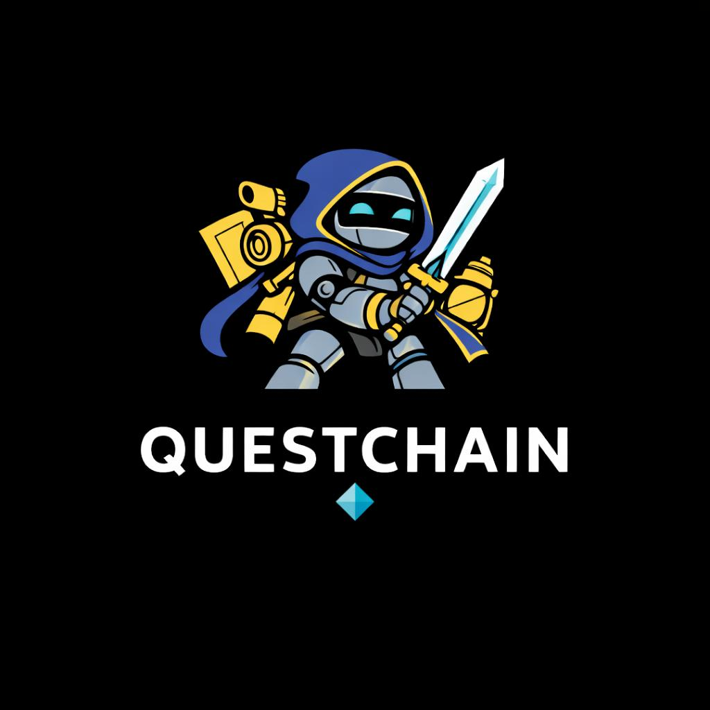
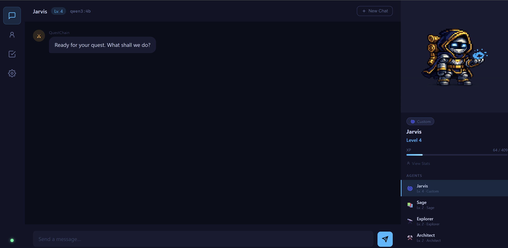
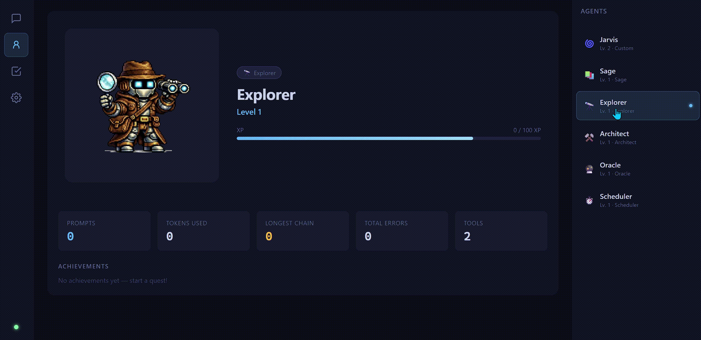

<div align="center">



# Truly Local. Always On. Ready for Tasks.

### Your AI assistant, running on your hardware, working for you around the clock.


[](https://python.org)
[](https://ollama.com)
[](https://github.com/RayP11/QuestChain/blob/master/LICENSE)

[](https://discord.gg/C8Rc3u7KKx)




</div>

---

QuestChain is an AI assistant that runs entirely on your machine. No cloud, no subscriptions, no usage limits. Just your hardware running a capable local model 24/7. It reads your files, runs shell commands, searches the web, schedules jobs, and works through your task list while you sleep. Model inference runs locally; enabled web search, Telegram, and other integrations communicate with their providers.

---

## Contents

- [Why QuestChain?](#why-questchain)
- [RPG Progression](#rpg-progression)
- [Quests](#quests)
- [Install](#install)
- [What It Can Do](#what-it-can-do)
- [Built for the Edge](#built-for-the-edge)
- [It Codes Itself](#it-codes-itself)
- [Terminal Commands](#terminal-commands)
- [Telegram Setup](#telegram-setup)
- [Most Tested Models](#most-tested-models)
- [Contributing](#contributing)
- [Built With](#built-with)

---

## Why QuestChain?

I tried [OpenClaw](https://github.com/OpenClaw-AI/OpenClaw) and was having a lot of fun playing around with it. However, I couldn't afford the api token cost and I wasn't able to run local models quickly without having to buy even more expensive hardware. So I was inspired to create a framework which could run models as small as 3B autonomously and productively.

QuestChain is that framework: a main assistant and manually selected specialists with focused tool loadouts, and with a twist of gamification.

### At a glance

| | **QuestChain** |
|---|---|
| Language | Python |
| Lines of code | ~9,000 |
| Source files | 40 |
| Multi-surface (CLI, Telegram, Web) | ✅ |
| RPG progression | ✅ |
| Custom async agent engine | ✅ |

---

## RPG Progression

<div align="center">

</div>

QuestChain isn't just a tool. It's a companion you build over time. Every agent starts at Level 1 and earns XP through real work: tool calls, completed tasks, background jobs, and extended conversations. The more your agent works, the stronger it gets.

Each agent has:

- Levels (1-20)
- A class
- Achievements
- Progression
- Behavior
- Tools

### Classes

Classes are QuestChain's micro-agent system. Each class is a specialized agent with its own role, tool loadout, and independent progression. Keeping agents focused on a single domain is best practice for local models. A smaller context, fewer tools, and a clear identity means better decisions and fewer hallucinations.

| Class | Icon | Specialty | Tool Preset |
|---|---|---|---|
| Custom | 🌀 | You decide | You configure |
| Legacy Coordinator | 🧭 | Manually selected legacy profile | No execution tools |
| Keeper | 📚 | Files & knowledge | File tools |
| Explorer | 🔭 | Research & discovery | Web search + browse |
| Builder | ⚒️ | Code & systems | Files and shell; optional Claude Code |
| Planner | 🔮 | Planning & strategy | File tools |
| Scheduler | ⏱️ | Automation | Quests only |

---

## QuestChain and manually selected specialists

Select **QuestChain**, **Researcher**, **Workspace**, **Builder**, or **Scheduler** yourself. Each uses its own configured tools, model and prompt and answers you directly. No automatic routing or private delegation takes place. Switch through the chat roster, Agents page, or `/agents` in terminal and Telegram. Main QuestChain is configurable too.

New Chat and saved history remain separate per interface; agent model context is scoped to that agent. Upgrading preserves existing identities, permissions, custom prompts and schedules. Previously archived definitions can still be imported explicitly; paused schedules are not resumed. See the [agent and migration guide](docs/agent-classes.md).

## Quests

Quests is the new name for the persistent scheduler. `/quests` is the preferred command; `/cron` remains a compatible alias. Existing schedules, IDs, paused state, results, and history are unchanged. Technical cron expressions, `cron_*` tool names and WebSocket messages, and the `cron_jobs.json` storage file retain their names. The `cron-jobs` skill and documentation URL remain stable. This rebrand does not restore the retired quest-file runner, `/quest` commands, or `--quests` / `--no-quests` startup flags.

Automate recurring work from the **Quests** page, the terminal `/quests` menu, or Telegram `/quests` commands. Jobs share one persistent scheduler and run while QuestChain is open.

Each job has a name, instructions, a schedule, timezone, and assigned agent. The web UI uses a standard time selector; terminal and Telegram commands accept cron expressions. Create, edit, pause, resume, run now, or delete a job. The web UI shows its next run, last status, and result. Results also appear in the terminal, or on Telegram when connected.

```text
/quests add Morning summary | 0 9 * * mon-fri | America/New_York | Summarize my notes
/quests list
/quests show JOB_ID
/quests pause JOB_ID
/quests resume JOB_ID
/quests run JOB_ID
/quests delete JOB_ID
```

Use weekday names (`mon`–`sun`); numeric weekdays follow APScheduler: Monday=0, Sunday=6. Pausing or deleting a job prevents future runs; a run already underway finishes.

The old quest folder and periodic quest runner have been retired. Existing quest files remain on disk and are no longer executed. Recreate desired recurring tasks as quests. The `--quests` and `--no-quests` startup flags have been removed.

---

## Install

### Step 1: Install Ollama

Download and install Ollama from [ollama.com/download](https://ollama.com/download), then start it:

```bash
ollama serve
```

Leave it running, then open a new terminal for the next step.

### Step 2: Install QuestChain

**Windows:** open PowerShell and run:

```powershell
powershell -ExecutionPolicy Bypass -c "irm https://raw.githubusercontent.com/RayP11/QuestChain/master/install.ps1 | iex"
```

**macOS / Linux:** open a terminal and run:

```bash
curl -fsSL https://raw.githubusercontent.com/RayP11/QuestChain/master/install.sh | bash
```

### Step 3: Run

```
questchain start
```

On first run, QuestChain walks you through a short onboarding conversation and optionally sets up Telegram. After that, it remembers who you are.

> **Web search (optional):** Run `/tavily` inside QuestChain to set up your free [Tavily API key](https://tavily.com) and enable web search and browsing.

### Startup Cheat Sheet

```bash
questchain start                      # Start with default model
questchain start -m qwen3:4b          # Use a specific model
questchain start -t <thread-id>       # Resume a previous conversation
questchain start --web                # Start with web UI (gateway + CLI)
```

The web control plane binds only to loopback (`127.0.0.1`, `localhost`, or `::1`).
Direct LAN/wildcard binding is rejected. For remote use, keep it on loopback and
connect through an authenticated SSH tunnel, for example
`ssh -N -L 127.0.0.1:8765:127.0.0.1:8765 your-host`, then open `http://localhost:8765`.
Do not publish the tunnel port or put the gateway behind a public forwarding proxy.

Set `QUESTCHAIN_WS_TOKEN` to a strong private password to require authentication
for both the web page and WebSocket. The browser login username is `questchain`;
the password is that setting's value. The secret is never included in the HTML.
Existing native WebSocket clients can still use `?token=...`, but should prefer
HTTP Basic authentication headers to avoid putting secrets in URLs. Without a
password, local processes can control the application. This is a single-user
control plane with the application's OS privileges, not a sandbox or multi-user
service. Existing direct-network `--web-host` configurations must switch to a
loopback tunnel.

### Updating an installed copy

Exit QuestChain with Ctrl+C, Ctrl+D, or `/exit`, then run:

```bash
questchain --update
```

If an older version's updater fails to launch, update directly with:

```bash
uv tool install git+https://github.com/RayP11/QuestChain@master --reinstall
```

Restart QuestChain after updating. Your settings, agents, and conversation history remain in the data directory.

### Clone & Run (alternative)

If you want to clone the repo directly, modify the code, or run from source:

```bash
git clone https://github.com/RayP11/QuestChain.git
cd QuestChain
```

**Option A — uv sync (recommended, no manual activation needed):**
```bash
uv sync
uv run python -m questchain
```

**Option B — uv with venv:**
```bash
uv venv
source .venv/bin/activate   # macOS / Linux
.venv\Scripts\activate      # Windows
uv pip install -e .
python -m questchain
```

**Option C — plain pip with venv:**
```bash
python -m venv .venv
source .venv/bin/activate   # macOS / Linux
.venv\Scripts\activate      # Windows
pip install -e .
python -m questchain
```

> Ollama must still be running before starting QuestChain. See Step 1 above.

### Regression checks

Pull requests run Linux Python regressions, the chat Markdown JavaScript tests,
a strict documentation build, and a separate Windows launcher upgrade check.
The regression tests use fake model responses; Ollama and API keys are not needed.
To reproduce the Linux checks with Python 3.13, Node.js 24, and uv 0.13.5:

```bash
uv sync --locked --python 3.13
QUESTCHAIN_DATA_DIR="$(mktemp -d)" uv run --no-sync python -m pytest -q -ra
node --test tests/chat-markdown.test.cjs
uv tool run --from mkdocs-material==9.6.23 mkdocs build --strict
```

The two launcher tests are intentionally skipped on Linux. The Windows CI job
runs only `tests/test_updater_windows.py`, using temporary offline wheels and
isolated uv tool directories; it does not claim full Windows regression coverage.
PR checks have read-only repository permissions, no persisted checkout credentials,
no shared caches or application secrets, and bounded GitHub-hosted jobs. The
existing documentation deployment workflow remains separate. Application
dependencies come from `uv.lock`; documentation and launcher test tools have
pinned direct versions but their transitive dependencies are not locked. When
updating action pins, verify the full commit against the upstream release tag.

---

## What It Can Do

- 🔍 **Web Search & Browse:** Find current information and extract full page content via Tavily *(optional)*
- 📁 **File Operations:** Read, write, edit, list, search files on your real filesystem
- 💻 **Shell Commands:** Run terminal commands and scripts directly
- 🖥️ **Self-Coding:** Delegate programming tasks to Claude Code; modify its own codebase *(optional)*
- ⏰ **Quests:** Schedule recurring tasks that run automatically and report back
- 📱 **Telegram Bot:** Access QuestChain remotely from your phone
- 💾 **Persistent Memory:** Learns your preferences and saves notes across sessions
- 🗣️ **Voice Output:** Speak responses aloud via Kokoro TTS (CLI) or Telegram voice messages

---

## Built for the Edge

Most AI tools assume cloud infrastructure and always-online connections. QuestChain runs on the hardware you already own, reliably on models as small as **3B parameters**, and is built so that nothing has to leave your machine.

> *"All the power of AI, none of the cloud bills."*

**Performance on constrained hardware:**
- **No bloat.** The entire agent loop is ~100 lines of Python. No framework overhead, nothing between the model and your machine.
- **Context is managed automatically.** When memory fills up, QuestChain summarizes older conversation and keeps going. No crashes, no cutoffs.
- **Tools run in parallel.** Web search, file reads, and shell commands execute simultaneously when needed.

**Private by design:**
- **Nothing reachable from outside:** runs only on your computer, never exposed to the internet.
- **No store, no strangers' code:** no online marketplace, no telemetry, nothing phoning home.
- **No accounts, nothing to steal:** optional API keys stay in a local file and go nowhere else.
- **Works with no internet at all:** disconnect your machine and QuestChain keeps working.

Want to go further? Two optional integrations are a single command away: [Tavily](https://tavily.com) for live web search, and [Claude Code](https://claude.ai/code) for delegating coding tasks. Both are opt-in and only activate when you call them.

---

## It Ships

QuestChain can delegate programming tasks to [Claude Code](https://claude.ai/code) (Anthropic's coding agent) with full access to your filesystem. It uses this to develop its own codebase: describe a bug or feature, and QuestChain hands it off, reviews the result, and reports back.

My own QuestChain agent Jarvis has actually started vibing its own features and pushing code to this repo.

> **No Claude Code?** Try running a local coder model instead. Try `deepseek-coder-v2:16b` for maximum capability, or `qwen2.5-coder:7b` for a lighter option.

---

## Terminal Commands

| Command | Description |
|---|---|
| `/help` | Show all available commands |
| `/new` | Start a fresh conversation |
| `/model` | Change the global default model; restart to apply |
| `/tools` | Show the selected agent's tools and availability |
| `/quests` | Open the Quests menu; `/quests help` shows text commands |
| `/agents` | Select or configure QuestChain and specialists |
| `/runs` | List runs in the current conversation |
| `/retry [run ID]` | Retry the last run or a specified run in this conversation |
| `/cancel [run ID]` | Cancel a queued or running task in this conversation |
| `/history` | Browse and switch past conversations |
| `/legacy [migrate ID]` | List archived agents or restore one |
| `/stats` | Show agent metrics: prompts, tokens, errors |
| `/level` | Show agent level and achievements |
| `/prestige` | Prestige reset; requires Level 20 |
| `/onboard` | Re-run the onboarding conversation |
| `/tavily` | Set up Tavily web search API key |
| `/claudecode` | Set up Claude Code CLI integration |
| `/telegram` | Set up Telegram bot credentials |
| `/speak` | Set up Kokoro TTS voice output |
| `/exit` | Exit QuestChain |
| **Ctrl+C** / **Ctrl+D** | Exit QuestChain |

---

## Telegram Setup

QuestChain runs alongside the CLI as a Telegram bot, giving you remote access from your phone.

Run `/telegram` inside QuestChain and it walks you through the setup:

1. Message [@BotFather](https://t.me/botfather) on Telegram → `/newbot` → copy the token
2. Message [@userinfobot](https://t.me/userinfobot) → copy your numeric user ID
3. Paste both into the `/telegram` wizard. Credentials are saved automatically.

Restart QuestChain and the bot starts alongside the CLI. Telegram conversations are scoped to the destination chat and do not share the terminal's conversation history.

### Telegram commands

| Command | Description |
|---|---|
| `/start`, `/help` | Show the introduction or command list |
| `/new` | Start a fresh conversation and clear the previous run selection |
| `/model` | Show the selected agent's current model, including its override |
| `/tools` | Show the selected agent's tools and availability |
| `/agents` | Select, create, edit, or import specialists |
| `/quests` | List quests and show scheduling commands |
| `/runs [run ID]` | List this conversation's runs, or read one saved result |
| `/history [conversation ID]` | List this chat's saved conversations, or resume one |
| `/retry [run ID]` | Retry the latest run or a specified run in this conversation |
| `/cancel [run ID]` | Cancel a run in this conversation; without an ID, also cancels agent creation |
| `/level` | Show agent level and achievements |
| `/stats` | Show agent metrics: prompts, tokens, errors |
| `/onboard` | Re-run the onboarding conversation |

Use `/runs page N` or `/history page N` to browse more than 20 entries. Resuming a conversation shows its latest 10 saved requests and answers; use `/runs ID` for older results. History stays within the same Telegram chat, even after restarting QuestChain. `/new` preserves old history without carrying its run selection into the new conversation.

---


## Most Tested Models

Any Ollama model works. These are the most tested:

| Model | VRAM | Notes |
|---|---|---|
| `qwen3:8b` | ~6 GB | **Default.** Fast, excellent tool calling, native thinking |
| `qwen3:4b` | ~3 GB | Compact. Solid tool calling, native thinking |
| `qwen3.5:9b` | ~7 GB | Strong tool calling |
| `qwen3.5:4b` | ~3.5 GB | Lightweight, reliable tool calling |
| `qwen3:1.7b` | ~2 GB | Ultra-light. Runs on CPU or minimal VRAM |

```bash
questchain start -m <any-model>  # use any model installed in Ollama
```

---

## Contributing

Contributions are welcome. Bug reports, feature requests, and pull requests all help.

- **Issues:** [github.com/RayP11/QuestChain/issues](https://github.com/RayP11/QuestChain/issues)
- **Discussion & ideas:** [Join the Discord](https://discord.gg/C8Rc3u7KKx)
- **Self-hosted development:** QuestChain can write and test its own code. See [It Codes Itself](#it-codes-itself)

---

## Built With

<div align="center">

[](https://ollama.com)
[](https://tavily.com)
[](https://claude.ai/code)
[](https://core.telegram.org/bots)
[](https://github.com/Textualize/rich)

</div>

- **Custom async agent engine:** purpose-built for edge AI; lightweight, streaming, parallel tool execution
- **[Ollama](https://ollama.com):** run any open-weight LLM locally with one command
- **[Claude Code](https://claude.ai/code):** Anthropic's coding agent; QuestChain delegates programming tasks to it
- **[Tavily](https://tavily.com):** web search and full-page extraction API
- **[python-telegram-bot](https://python-telegram-bot.org):** Telegram bot SDK
- **[APScheduler](https://apscheduler.readthedocs.io):** async cron scheduling
- **[Kokoro ONNX](https://github.com/thewh1teagle/kokoro-onnx):** fast local text-to-speech
- **[Rich](https://github.com/Textualize/rich):** beautiful terminal output
- **[prompt-toolkit](https://python-prompt-toolkit.readthedocs.io):** interactive terminal input with history

---

<div align="center">
<sub>No cloud. No cost. No compromise. Small but mighty. Send your hardware on a quest.</sub>
<br><br>

### 💬 [Join the QuestChain Discord](https://discord.gg/C8Rc3u7KKx)
**Share agents, get help, and follow development.**

<br>
<sub>If QuestChain is meaningful to you, a ⭐ helps others find it.</sub>
</div>

## Manual specialist selection

Choose QuestChain or a specialist directly from the chat roster, Agents page, terminal `/agents`, or Telegram `/agents`. The selected agent uses its own configured tools and model. Automatic agent-to-agent routing/delegation is disabled. Scheduled quests execute as their assigned agent without a second synthesis step. See [agent behavior and migration](docs/agent-classes.md).
